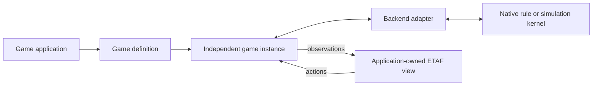

# Architecture

GameKit is a framework consumed by game applications. Its public starting point
is a game definition, followed by an independent running instance. Backends are
replaceable providers beneath that application contract.

## Responsibilities

| Owner | Responsibility |
| --- | --- |
| Game application | Game identity, rules/content, assets, ETAF views, local interaction state and launch command |
| Game definition | Inert binding of identity, backend configuration, view factory and observation validator |
| Game instance | Process ownership, ordered actions, state publication, errors and mounted-view lifetime |
| Backend adapter | Translate game configuration and native kernel operations into the common wire contract |
| Native kernel | Authoritative rules, simulation or turns, legal actions and saved-state semantics |
| ETAF and etaf-ui | General rendering/reactivity/input and optional catalog components used by the application |

The framework has no application launcher, game menu, theme or game-specific
view. Requiring its entry loads ETAF and the generic framework modules only.
It does not load etaf-ui or any game application. Applications require the
catalog when they need it. Games live in independent repositories under the
`etaf-games` workspace and consume only the framework's declared public APIs.
Their rules, presentation, GUI scenarios and game-specific workloads belong
to those repositories; framework fixtures exercise generic backend contracts.

## Definition and instance lifetime

Defining a game starts no process and mounts no view. Its configuration is
validated and detached from caller-owned values. Starting that definition
creates a new instance and overlays per-instance options onto a fresh copy.
The game name and title are available before the first view is constructed.
Definitions can be reused; no authoritative game state is shared between starts.

The registry belongs to backend authors. A launch function prepares a command
from game configuration; the instance owns starting, communicating with and
closing that process. Replacing or unregistering a backend affects future
starts. Existing instances retain their process, game metadata and lifetime.

The instance's mount owns the presentation lifetime. Killing or unmounting its
buffer closes the backend, cancels pending work and prevents later publication.
Transport failure retains the last accepted observation and explanatory error.
Snapshots are explicit and backend-owned; closing never implies a save.
The [manual](manual.md#adapter-wire-contract) owns framing, ordering and errors.

## State and presentation

The kernel is the only authority for rules and world state. Applications own
selection, dialogs and other presentation state. Detached observations flow
through reactive values, with unchanged values retained by equality. Streams
coalesce to at most sixty publications per second; acknowledged actions publish
on the next event-loop turn. The view may skip intermediate observations but
always has access to the latest accepted one.

No universal board, story or world schema is imposed. A game supplies a schema
or uses its adapter's documented native projection. Asset IDs resolve through
the game's content manifest; binary media stays outside the state protocol.
A rendered canvas is published as per-line image strips, and only a small
frame description travels in the observation. GameKit supplies the client
canvas component and the shared Godot strip publisher; the application owns
its geometry, artwork and the mapping from its world to the canvas.
Applications compose ETAF image/video facilities and optional
etaf-ui media components. GameKit currently supplies no asset downloader,
audio mixer or network synchronization service.

Intrinsic world/tile dimensions belong to the game's presentation design.
Window adaptation reflows surrounding controls and panels without stretching
the world. Reusable primitives stay in their owning ETAF/UI providers, rather
than being copied into either GameKit or applications.

## Included native adapters

Godot supplies a simulation runtime. Its shared bridge owns stdin, correlation
and changed-state publication. It consumes queued commands before the node
physics step and flushes their ordered replies in the idle phase, sharing a
pipe write with a changed-state publication when one is due. Each reply still
contains its own post-command snapshot;
sharing a pipe write lets the frontend coalesce a burst without preparing
intermediate pictures that would never be displayed. A game project supplies
commands and observations while using Godot's physics, collision, navigation
and simulation APIs. The
bridge runs [headlessly](https://docs.godotengine.org/en/stable/tutorials/export/exporting_for_dedicated_servers.html);
there is no game-rendering window and no frame transport in the process
protocol. A rendering game publishes strips as files and reports a frame
description, as described under state and presentation. GameKit does not
contain that project's rules or UI.

The boardgame.io adapter consumes an application-owned Game module through the
[public Client API](https://github.com/boardgameio/boardgame.io/blob/v0.50.2/docs/documentation/api/Client.md).
The library owns turns, phases, player views, move validation and random state.
The included path is a local match. Its pinned release lacks public state
loading, so an opaque snapshot replays seeded commands into a candidate client
and verifies the resulting observation before replacing the live match. It
never dispatches private Redux actions or changes library internals.

OpenSpiel supplies existing rule kernels. The adapter uses its public state,
legal-action, chance, joint-action and native serialization APIs. It preserves
the chosen player's observation and information-state boundaries rather than
publishing an unfiltered native state. Explicit chance is resolved by an owned
seeded RNG. Native snapshot restoration and RNG validation occur before the
live state changes. A sequential kernel also advertises the `bot` operation,
which plays one move for the side to move under the adapter's own search policy
and reports that decision in the observation; it is an ordinary player action
for undo, redo and snapshots. Mean-field and sampled-stochastic games need
specialized adapters. Discovering a native game name does not certify its
frontend or all of its lifecycle paths.

## Engine selection boundaries

| Need | Provider and status |
| --- | --- |
| Real-time physics, collision and navigation | Included Godot backend; applications supply game projects |
| Application-defined tabletop/card rules, turns and phases | Included boardgame.io backend; local matches, player views and replay snapshots |
| Existing rules with legal-action APIs and native snapshots | Included OpenSpiel backend; sequential/simultaneous kernels with explicit chance |
| Strong chess, Go, shogi or mahjong rules/search | UCI, GTP, USI or mjai providers belong in specialized backend plugins; none is installed implicitly |
| Existing portable puzzle rules | Tatham's collection needs an adapter for its frontend/drawing contract, not just a serialization wrapper |
| Persistent worlds, roguelike utilities or branching narrative | Evennia, non-rendering rot.js/tcod facilities, Ink or other providers can implement a backend plugin |
| Small in-process management rules | A game can use ETAF and its own pure state kernel directly; the current GameKit backend transport is process-based |

A shared game-authoring and instance contract does not make native kernels
interchangeable. Games still select the provider that owns the required rules
or simulation. Backend features describe capabilities; active observations and
native validation determine whether an action is legal now.

Godot's supported headless APIs provide a usable non-rendering simulation path.
[OpenSpiel serialization](https://github.com/google-deepmind/open_spiel/blob/master/docs/api_reference/game_serialize_game_and_state.md)
is not a universal JSON world model, and
[Tatham's collection](https://www.chiark.greenend.org.uk/~sgtatham/puzzles/)
contains dozens of puzzle types with a drawing interface. The framework exposes
these boundaries without pretending every provider produces the same game UI.
